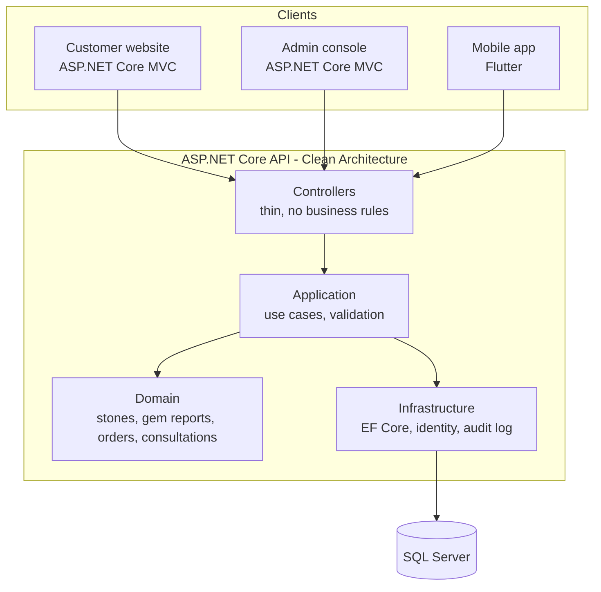

<div align="center">

# Balasingam Kowarththanan

<a href="https://github.com/KowaBala996">
  
</a>

I design and ship end-to-end products — domain model, API, web, admin and mobile — and I own them in production.

[](https://portfolio2-murex-psi.vercel.app)
[](https://linkedin.com/in/kowabala996)
[](mailto:kowabala996@gmail.com)
[](https://x.com/kowabala996)


[](https://github.com/KowaBala996)

</div>

---

## About

- **Full-Stack Engineer & Associate Software Developer** — ASP.NET Core, Angular, Flutter, SQL Server.
- I build **whole products, not just tickets**: one domain model behind a customer website, an admin console and a mobile app.
- I like the hard parts — **payments, subscriptions, point-of-sale integrations** — and design idempotency, audit trails and failure handling in from day one.
- Exploring **local LLMs and RAG** for private, on-premise business assistants.

## What I'm building now

| Product | What it is | Stack |
|---|---|---|
| 💎 **Luxury gemstone commerce platform** | Customer website, admin console and mobile app for certified natural Ceylon gemstones | ASP.NET Core · Angular SSR · MVC · Flutter · SQL Server |
| 📅 **Multi-business booking SaaS** | Per-business subscriptions, platform fees and online payments | ASP.NET Core · Clean Architecture · CQRS · EF Core |
| 🧾 **EPOS Now integration API** | Connects point-of-sale data with external systems | ASP.NET Core · REST · background sync |

### 🏗️ How the gemstone platform fits together



One domain model, three clients — every rule lives once, in the API.

## Featured projects

| Project | Highlights | Stack |
|---|---|---|
| 🤖 [**Chatbot_AI**](https://github.com/KowaBala996/Chatbot_AI) | Private business assistant on a **local LLM** (Mistral via Ollama). Answers from internal data by prompt injection or **RAG** (embeddings + vector store) — no cloud APIs | .NET 8 · Flutter · Ollama · Docker |
| 📝 [**python-AI**](https://github.com/KowaBala996/python-AI) | AI text summarizer with tunable length and sampling | Python · Streamlit · BART |
| 🎓 [**GPA Insight**](https://github.com/KowaBala996/New-folder--2-) | Academic tracker — grade prediction, study-time optimizer, what-if analysis | Python · Streamlit · scikit-learn · Plotly |
| 🚗 [**Car Rental System**](https://github.com/KowaBala996/Car_rental_Group-3_Back_end) ([front end](https://github.com/KowaBala996/Car_Rental_Management_system_Group-3_Front_end)) | Team project — registration, car categories, payments, customer and manager dashboards | ASP.NET Core · SQLite · JavaScript |
| 🧩 [**Angular + ASP.NET Core 8**](https://github.com/KowaBala996/Anguler_Visual_studio_MVC-project-using-.Net-Core-8.0) | Angular front end and ASP.NET Core MVC in one solution | Angular · ASP.NET Core 8 · Docker |
| 🌐 [**Portfolio**](https://portfolio2-murex-psi.vercel.app) ([source](https://github.com/KowaBala996/9)) | Personal portfolio — [v1 also live](https://my-portofolio-opal-alpha.vercel.app) | React · Vite · Vercel |

## Tech stack

<p align="center">
  <br/>
  <br/>
  <br/>
  
  
  
  
</p>

## How I work

- **Design before code** — non-trivial changes start with a short note: problem, options, decision, trade-offs.
- **Clean boundaries** — Clean Architecture and CQRS, thin controllers, testable use cases, migrations under version control.
- **Every change reviewed** — pull requests, CI on every push, a definition of done that is actually checked.
- **Every screen, every phone** — UI is done only when it works from 320 px to foldables, upright and sideways.
- **Secure by default** — OWASP habits, secrets out of code, dependency audits.
- **Own it in production** — structured logs, meaningful errors, safe migrations and a rollback plan.

## GitHub activity

<div align="center">

| 📦 Repositories | 🔨 Commits | 🔀 Merged PRs | 🐞 Issues | 📅 On GitHub since |
|:---:|:---:|:---:|:---:|:---:|
| **43** <br/><sub>24 public · 19 private</sub> | **350+** | **37** | **12** | **Oct 2024** |

<sub>Counted across public and private repositories, Nov 2026.</sub>

<br/>

  
  <br/><br/>
  <picture>
    <source media="(prefers-color-scheme: dark)" srcset="https://raw.githubusercontent.com/KowaBala996/KowaBala996/output/github-contribution-grid-snake-dark.svg" />
    
  </picture>
</div>

<details>
<summary><b>🧮 Dev breakdown</b> — across 37 repositories, Nov 2026</summary>

<br/>

_Languages by share of code (generated Flutter platform code excluded); everything else by number of repos that use it._

```text
💻 Languages
C#             █████████████████████████  25.1%
HTML           ███████████████████████░░  23.1%
TypeScript     ██████████████████████░░░  22.4%
Python         ████████░░░░░░░░░░░░░░░░░   8.5%
JavaScript     ███████░░░░░░░░░░░░░░░░░░   7.4%
Dart           ███████░░░░░░░░░░░░░░░░░░   7.3%
CSS            █████░░░░░░░░░░░░░░░░░░░░   5.2%

🧰 Frameworks
.NET           █████████████████████████  12 repos
Angular        ████████░░░░░░░░░░░░░░░░░   4 repos
React          ████████░░░░░░░░░░░░░░░░░   4 repos
Flutter        ██████░░░░░░░░░░░░░░░░░░░   3 repos
Streamlit      ██████░░░░░░░░░░░░░░░░░░░   3 repos

🗄️ Databases
SQL Server     ██████░░░░░░░░░░░░░░░░░░░   3 repos
SQLite         ██████░░░░░░░░░░░░░░░░░░░   3 repos
PostgreSQL     ██░░░░░░░░░░░░░░░░░░░░░░░   1 repo

☁️ DevOps & hosting
Vercel         ██████████░░░░░░░░░░░░░░░   5 repos
Docker         ██████░░░░░░░░░░░░░░░░░░░   3 repos
GitHub Actions ██████░░░░░░░░░░░░░░░░░░░   3 repos
```

</details>

---

<div align="center">

**Open to full-stack .NET roles and freelance product work.**
[Get in touch](mailto:kowabala996@gmail.com) · [LinkedIn](https://linkedin.com/in/kowabala996)

</div>
